# Active Visual Tracking

✨We use embodied visual tracking tasks to benchmark embodied vision agents in complex dynamic environments.

## Introduction:

Embodied visual tracking is a challenging task that requires an agent to dynamically follow a moving target within a 3D environment, leveraging first-person vision and continuous interaction with the surroundings. We rely on the UnrealZoo platform to benchmark agents under realistic, ever-changing conditions to assess their robustness, adaptability, and generalization across diverse scenes.

UnrealZoo provides a wide collection of photorealistic, richly varied environments, as the playground for embodied AI agents. The diversity of settings and agents enables researchers to push embodied AI to new levels of capability, testing in scenarios that go beyond simple indoor navigation.

### UnrealZoo Key Features for Embodied Visual Tracking

- **Photo-realistic Dynamic Environments:** Designed to simulate a range of real-world challenges, including occlusions, dynamic lighting, irregular terrains, and multi-level structures.

- **Multi-Agent Scenarios:** Agents must navigate and track targets in dynamic settings with multiple moving agents and objects, promoting collaborative tracking for applications like rescue missions or surveillance.

- **Customizable Environment APIs:** Our improved API makes it easy for users to set up complex tracking tasks and interactions between the agent and its environment, including time dilation wrappers for control frequency tuning.

- **Data Collection API:** Users can collect visual datasets directly from the environment using UnrealCV+ with color, object masks, surface normals, and depth data capture.

## Evaluate Tracking Agents in UnrealZoo

Below are examples of the tracking agents' first-person views in four kinds of scenes:

📌Interior Scenes:

Agents deal with frequent low-level obstacles and narrow pathways, testing their occlusion handling and precise movements.

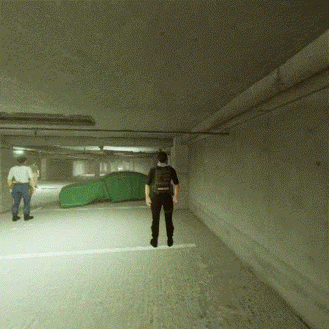

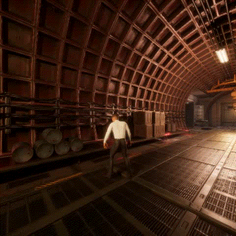

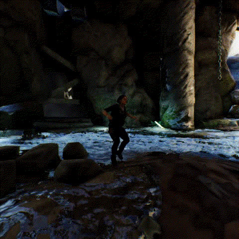

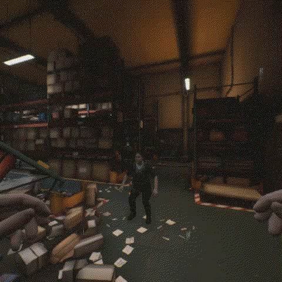

📌Palaces:

Agents face multi-level structures and intricate designs, where mastering spatial awareness is essential.

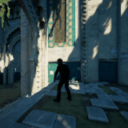

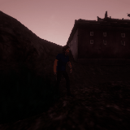

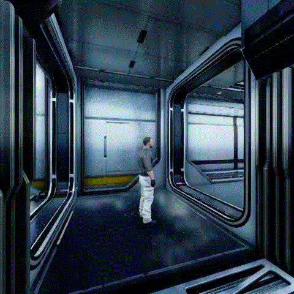

📌Wilds:

Irregular terrains and changing light conditions simulate outdoor tracking under unpredictable conditions.

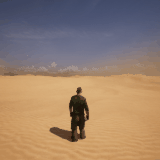

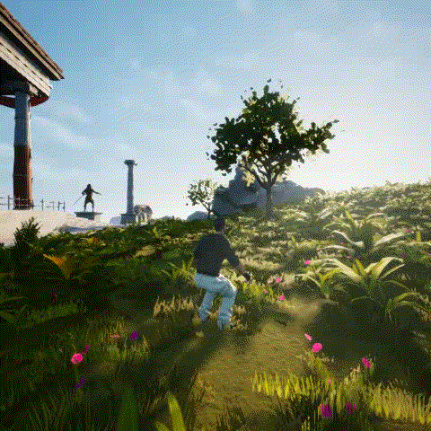

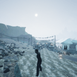

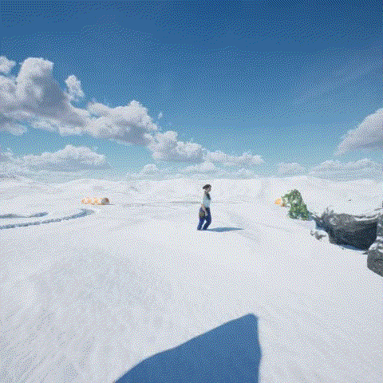

📌Modern Scenes:

These high-fidelity scenes represent real-world environments, such as Factories and parking lots, requiring agents to adapt to detailed and dense surroundings.

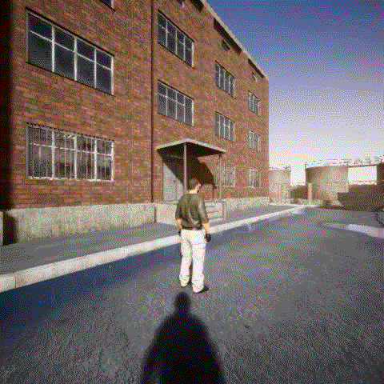

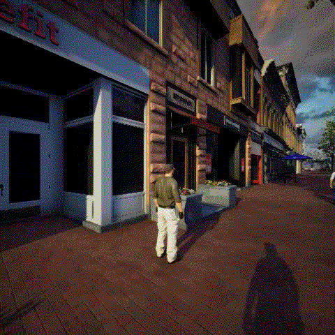

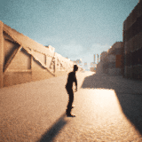

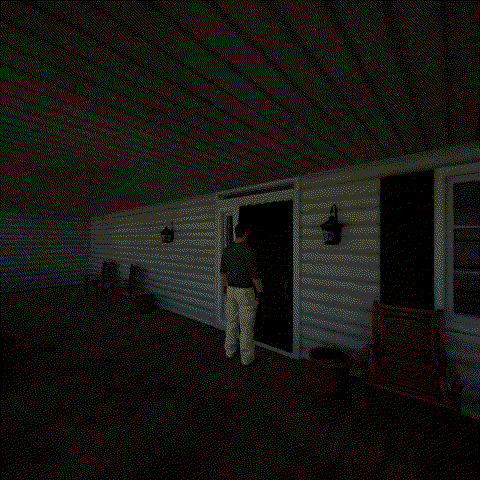

