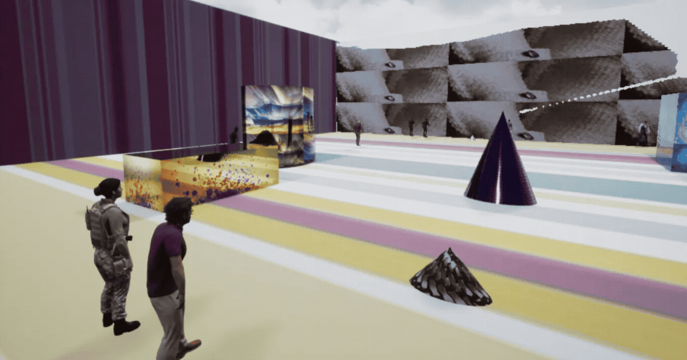
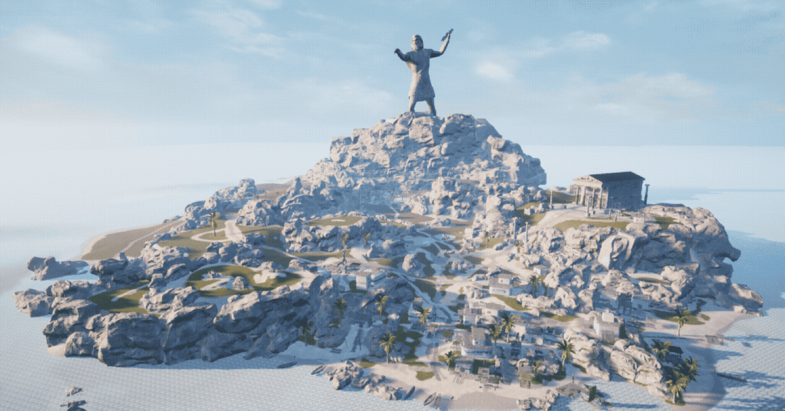
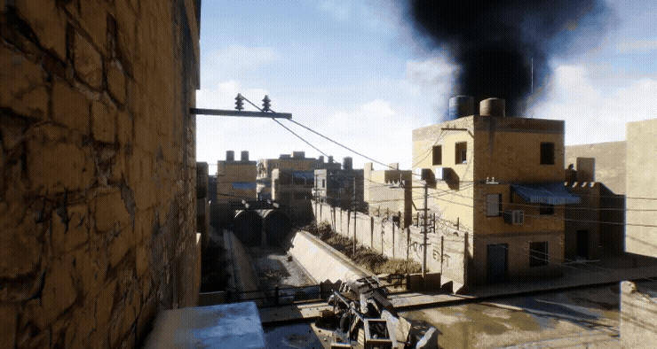
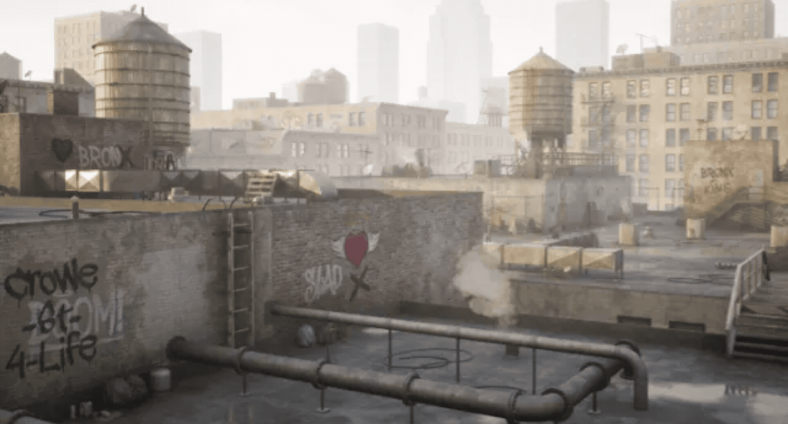

# Getting Started

# Download UE Binaries

### Download Examplar Binary

> 📌 We offer a lightweight binary for users to download and experience. 

The UE4 example contains 6 maps (<3GB):  

:linux:[Linux]            :win:[Windows]          :mac:[macOS]





.jpg)

.jpg)

.jpg)

.jpg)


The UE5 example contains 4 maps (~10GB): 

:linux:[Linux]            :win:[Windows]          :mac:[macOS]

> 📌 The global illumination and ray tracing are turned on by default.

.png)






### Full Version Binary Download (requires over 60GB of storage space)

:linux:[Linux]            :win:[Windows]          :mac:[macOS]

# Install UnrealCV+ Client

```bash
pip install unrealcv
```

# Install UnrealZoo-Gym

Download the unrealzoo-gym reprository from:

https://github.com/UnrealZoo/unrealzoo-gym

```bash
git clone https://github.com/UnrealZoo/unrealzoo-gym.git
cd unrealzoo-gym
pip install -e 
```


Move the downloaded binary to the UnrealEnv  folder, which is our default location for binaries, the folder structures are as follows:

```markdown
gym-unrealcv/
├── docs/                  
├── example/                
├── gym_unrealcv/              
│   ├── envs/    
│   |   |——agent/     
|   |   |——UnrealEnv/                    # Binary default location
|   |   |  |——Collection_WinNoEditor/    # Binary folder
|   |   |——setting/
|   |   |  |——env_config/                # environment config json file location  
...
generate_env_config.py                   # generate environment config json file
...
```

# Run Example Codes

> 📌 Available Env_Namein Examplar Binary:

| UE4 | UE5 |
| --- | --- |
| track_train | Map_ChemicalPlant_1 |
| Greek_Island | Old_Town |
| ContainerYard_Day | MiddleEast |
| ContainerYard_Night | Demo_Roof |
| SuburbNeighborhood_Day |  |
| SuburbNeighborhood_Night |  |

### 1. Run random agents

```bash
python ./example/random_agent_multi.py -e UnrealTrack-track_train-ContinuousColor-v0
```

> 📌 If your mouse cursor disappears after the game launches, press `  (the key above Tab) to release the mouse cursor from the game.


### 2. Run a rule-based tracking agent 

```bash
python ./example/tracking_demo.py -e UnrealTrack-Greek_Island-ContinuousColor-v0
```

### 3. Run a keyboard agent 

1. Control a tracking agent:
```bash
python ./example/keyboard_agent.py -e UnrealTrack-Old_Town-MixedColor-v0
```

> 📌 Use the "I", "J", "K", and "L" keys to control the human tracker and follow the target person closely, step by step.

 b. Control a navigation agent:

```bash
python ./example/keyboard_agent.py -e UnrealNavigation-Demo_Roof-MixedColor-v0
```

> 📌 Use the "I", "J", "K", and "L" keys to control the agent's movement.

Space( ␣ ): Jump.

Up Arrow(⬆️): Look up.

Down Arrow(⬇️): Look down.

(Double "Jump" will trigger the agent to climb)


> 📌 Explore All Scenes

Want to see all available environments? Visit our Scene Gallery to browse 100+ photo-realistic scenes, filter by category, and find the perfect environment for your research.

💡 Tip: You can find the complete list of environment names and their supported tasks in the Scene Gallery. Each environment has a unique ID following our naming convention (see Environment Naming Convention for details).


