# Import Custom Assets

> 📌 Usage guidance for importing custom asset PAK files into UnrealZoo.

# Import Custom Assets into UnrealZoo

> UnrealZoo supports loading custom Unreal Engine assets through standard Unreal Engine PAK files.

Users only need to package their assets into a .pak file and place it into the UnrealZoo  Paks directory. UnrealZoo will automatically mount and scan these assets during startup.

---

## Quick Start

1. Place your custom assets in your UE project, eg. YourProject/Content/MyAssets/ 
1. Create a PAK file from those assets
1. Place the PAK file in .../UnrealZoo_UE5_6_v3.0.1/Windows/UnrealZoo_UE5_6/Content/Paks/ 
1. Start UnrealZoo - assets are automatically mounted
---

## Prerequisites

- Unreal Engine 5.6 
- UnrealZoo v3.0.0 or newer
- Basic familiarity with Unreal Engine asset creation
---

# Step 1. Create a PAK File

UnrealZoo follows Unreal Engine's standard PAK loading mechanism.

Please refer to Epic Games' official tutorial:

Official Tutorial

https://dev.epicgames.com/community/learning/tutorials/7Bj8/unreal-engine-example-project-loading-pak-files-at-runtime

The general process is:

1. Create a normal Unreal Engine project.
1. Import your custom assets.
1. Cook the assets.
1. Package them into a .pak file.
---

## 1. Organize Assets

Place all assets that should be exported into a PAK under a dedicated folder.

Example:

```plain text
Content/
└── MyAssets/
    ├── Meshes/
    ├── Materials/
    ├── Textures/
    └── Characters/
```

---

## 2. Create a Primary Asset Label

In the Content Browser:

```plain text
Right Click
 └── Miscellaneous
      └── Data Asset
           └── PrimaryAssetLabel
```

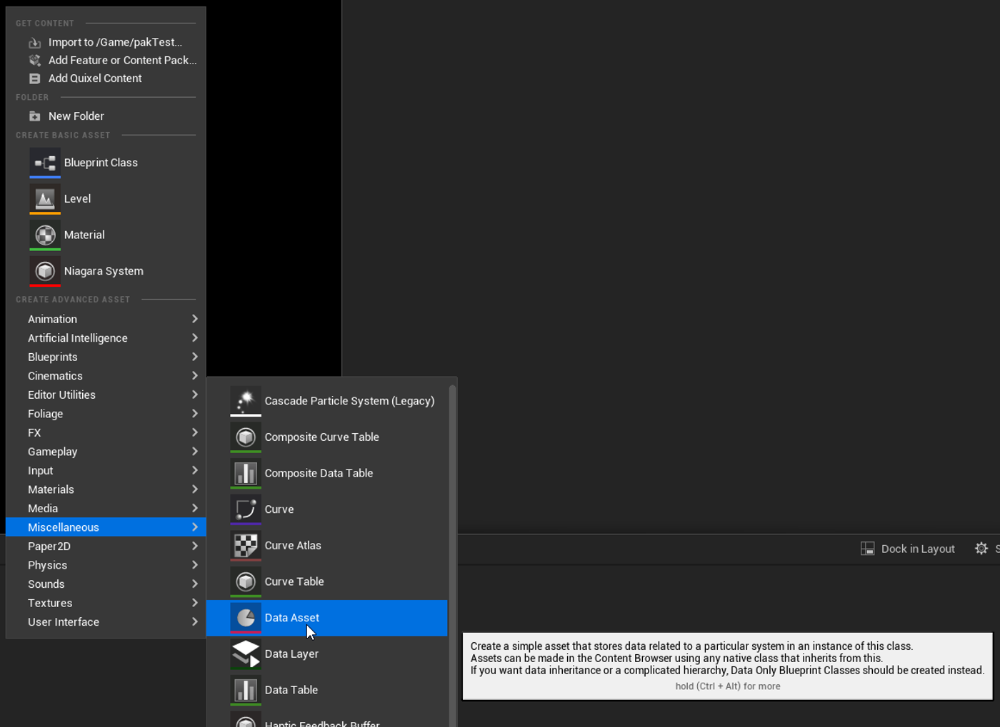

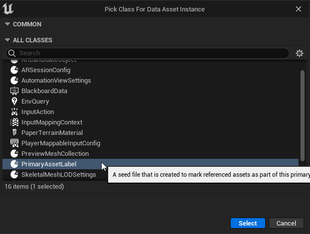

Create a new asset:

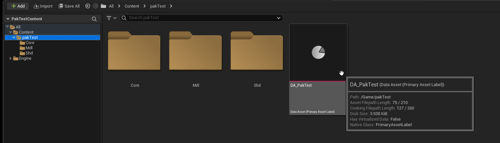

Configure the asset:

| Setting | Value |
| --- | --- |
| Chunk ID | 111 |
| Apply Recursively | Enabled |
| Cook Rule | Always Cook |


> Note:  ChunkId shall be any unique positive integer greater than 0 and must be unique within UnrealZoo. The two PAK files must be assigned distinct ChunkIds. Id 0 is reserved and unavailable for use. 

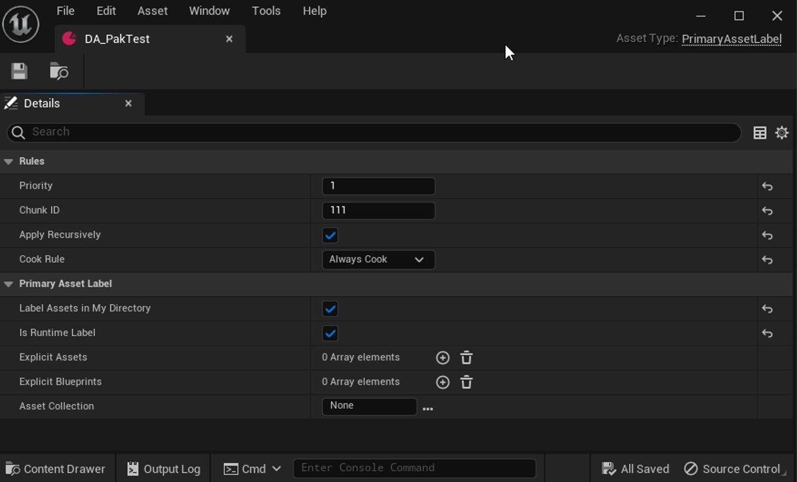


Next, add all assets intended for packaging into the PAK file to the Explicit Asset and Explicit Blueprint fields of the Data Asset. Conventional UAsset resources such as levels and meshes go into Explicit Asset, while character blueprints and similar blueprint assets are added to Explicit Blueprint.

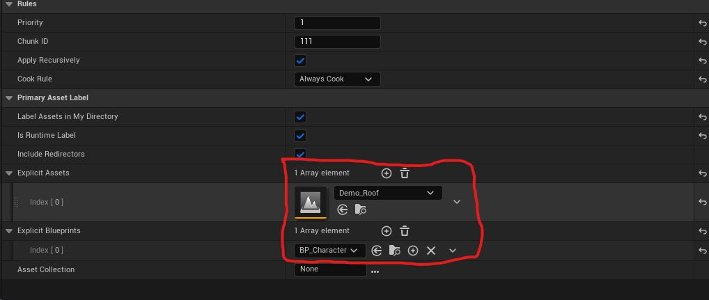

---

## 3. Configure Packaging

Open:

```plain text
Edit
 └── Project Settings
      └── Packaging
```

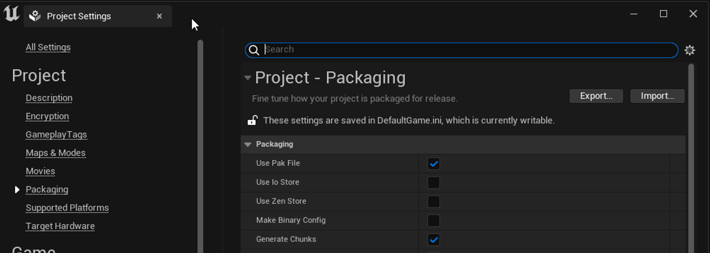

Open the Packaging pannel in Project Sttings.

Enable:

- Use Pak File
- Generate Chunks
Disable:

- Use Io Store
If “Use Io Store” is Enabled, please disable it. 

---

## 4. Configure Asset Manager

Open:

```plain text
Edit
 └── Project Settings
      └── Asset Manager
```

Open the Asset Manager pannel in Project Sttings.

Disable:

- PrimaryAssetLabel - Is Editor Only
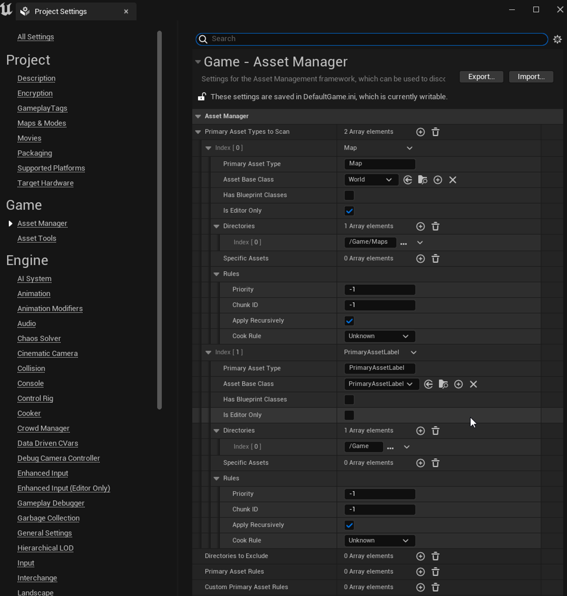

---

## 5. Package the Project

Package the project using the typical workflow:

```plain text
Platforms
 └── Windows
      └── Package Project
```

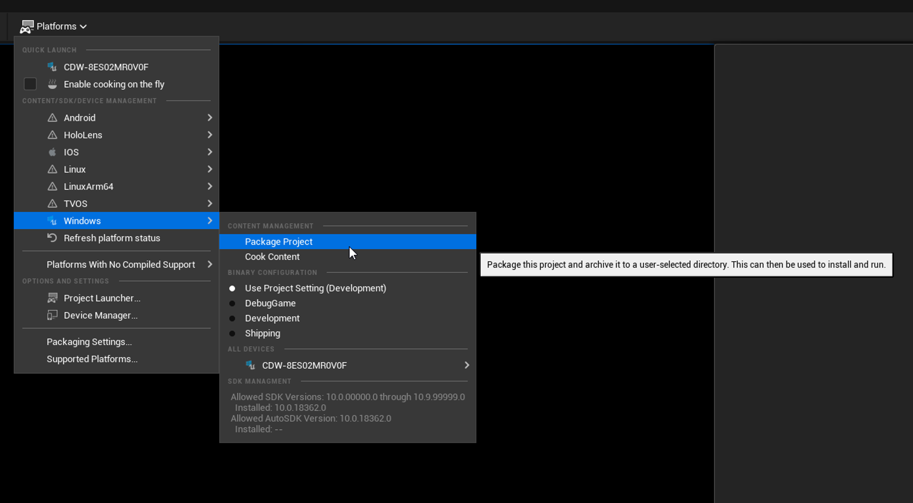


Choose an output directory:

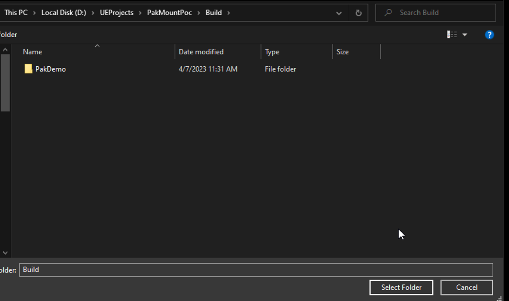


 Wait for packaging to complete:

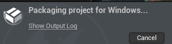


Unreal Editor will notify you when the packaging is completed:

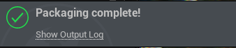

---

## 6. Locate the Generated PAK

After packaging, the generated PAK file can be found under:

```plain text
OutputPath/
└── Windows/
    └── YourProject/
        └── Content/
            └── Paks/
```

Example output:

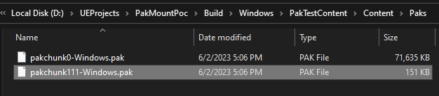

# Step 2. Import into UnrealZoo

After creating your .pak file, importing it into UnrealZoo only requires copying the file into the correct directory.

---

## Copy the PAK File

Place the generated .pak file into UnrealZoo's PAK directory.

Example:

```plain text
UnrealZoo-UE5/
└── UnrealZoo_UE5_6_v3.0.1/
    └── Windows/
        └── UnrealZoo_UE5_6/
            └── Content/
                └── Paks/
                    └── pakchunk111-Windows.pak
```

Multiple PAK files can be placed in this directory simultaneously.

---

## Start UnrealZoo

Launch UnrealZoo normally.

During startup, UnrealZoo will:

1. Search the Content/Paks/ directory.
1. Automatically mount all discovered PAK files.
1. Scan assets contained in the mounted PAKs.
