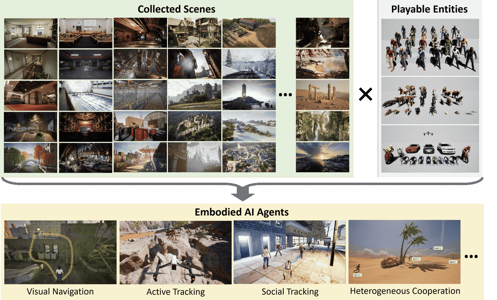

# UnrealZoo

UnrealZoo is a rich collection of photo-realistic 3D virtual worlds built on Unreal Engine, designed to reflect the complexity and variability of open worlds. There are various playable entities for embodied AI, including human characters, robots, vehicles, and animals.

Integrated with [UnrealCV](https://unrealcv.org/), UnrealZoo provides a suite of easy-to-use Python APIs and tools for various potential applications, such as data annotation and collection, environment augmentation, distributed training, and benchmarking agents.

> 💡 This repository (unrealzoo-gym) provides the gym interface based on UnrealCV APIs for UE-based environments, which is compatible with OpenAI Gym and supports the high-level agent-environment interactions in UnrealZoo.

## Why UnrealZoo?

| Platform capability | Research value |
|---|---|
| **100+ photo-realistic worlds and heterogeneous agents** | Evaluate embodied systems across urban, natural, architectural, and industrial scenes with humans, robots, vehicles, and animals |
| **Embodied perception** | Combine RGB-D, masks, panorama, LiDAR, and occupancy observations in the same interactive world |
| **Interactive multi-agent environments** | Study navigation, manipulation, vehicle interaction, tracking, and heterogeneous coordination |
| **Runtime extensibility** | Load external 3DGS environments, customize assets and appearances, and reuse existing agents and task APIs |
| **End-to-end agent workflows** | Connect Gym policies, VLN/VLM systems, Runtime MCP agents, and data-collection pipelines |

## Choose Your Workflow

| I want to work on | Start here | Runtime |
|---|---|---|
| **Multi-agent coordination / tracking** | Multi-agent baseline · Tracking example | Binary auto-launch |
| **Interactive navigation** | Keyboard navigation | Binary auto-launch |
| **RGB-D / LiDAR / occupancy perception** | v3.1 perception guide · LiDAR mapping · Occupancy viewer | Binary auto-launch |
| **MuJoCo robot physics (Go1 and Micro Duck)** | MuJoCo guide | Start binary or Editor manually |
| **VLN / VLM agents** | VLN baseline guide | Follow model-specific setup |
| **Runtime MCP agents** | Runtime MCP examples | Connect to a running environment |
| **Data collection / annotation** | Video recording pipeline · UnrealCV+ documentation | Start binary manually |
