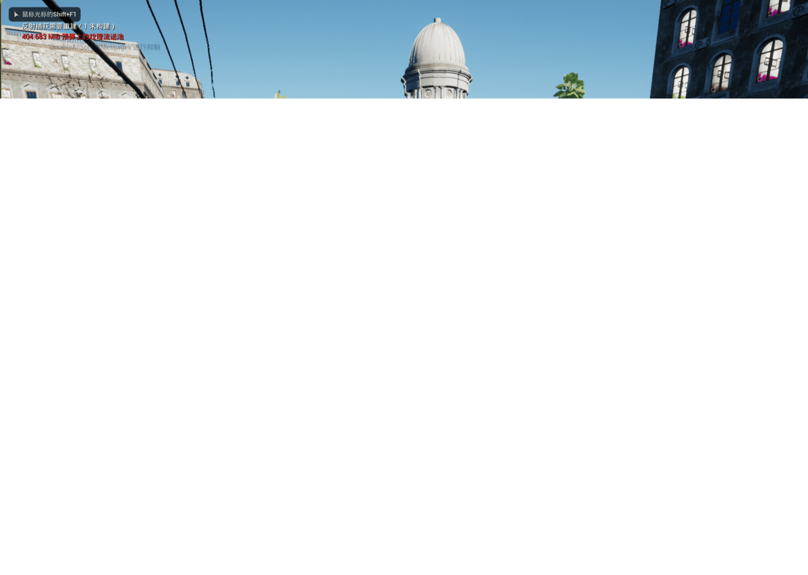

# Navigation System

In our environment, developers primarily have two ways to control agents' movements. Firstly, they can utilize the "set_move" function for step-by-step control of agents, which doesn't rely on additional plugins but requires developers to autonomously manage movement strategies through external code. Secondly, developers can construct a navigation system using the built-in navigation mesh in the UE engine to enable the autonomous movement of agents. Our environment integrates these two control methods. By combining BP function calls for step-by-step control with navigation system control, we can effectively utilize the navigation system to control secondary agents while employing step-by-step control for primary controlled agents. This combined approach offers advantages such as improved environment frame rates in multi-agent scenarios and higher precision control over primary agents.

BP_functions with Navigation system

| BP_function | input  | output  | help |
| --- | --- | --- | --- |
| nav_to_goal | {x} {y} {z} |  | Assign the agent a navigation goal, and use Navmesh and AI-controller built-in plugin to automatically control its movement to reach the goal via the shortest path. (The goal has to be reachable in the environment.) |
| nav_to_target | {target_object} {distance} |  | Assign the current agent to a target_object, utilize Navmesh and AI controller to dynamically follow the target_object, stopping at a specified distance from it |
| nav_random |  |  | control agent randomly wandering around |
| generate_nav_goal |  | { ”nav_goal”: “X=0.00 Y=0.00 Z=0.00” } | generate a reachable goal location around the agent, return the location. |

Example:

