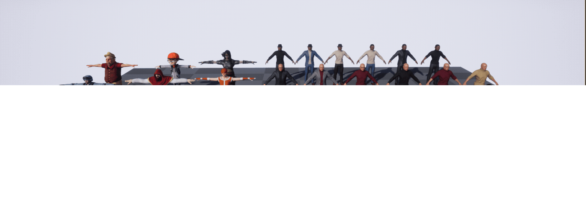
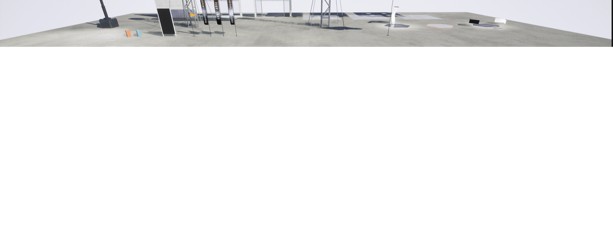
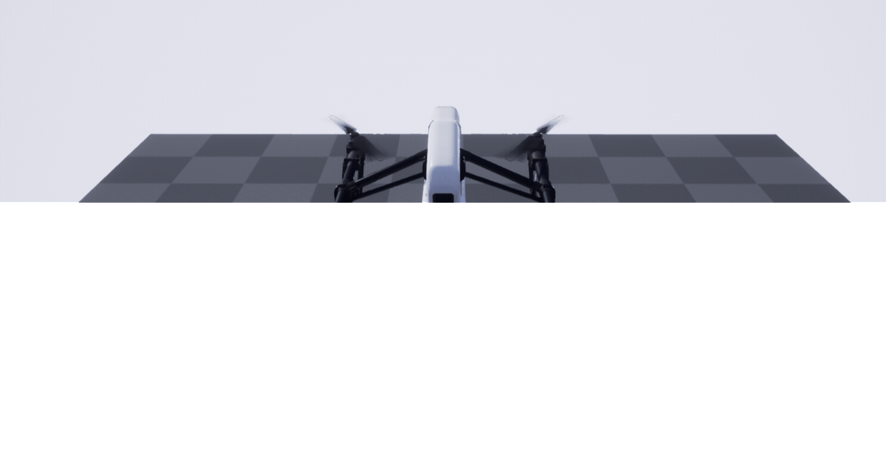

# Playable Entities

# Interactive embodied agents

We've created a range of interactive agents to address different training needs, like object tracking, autonomous driving, indoor/outdoor navigation, and drone tasks. Researchers can easily choose the agent types and environments they need for training. Our platform covers six main types of agents: virtual humans, animals, cars, motorcycles, and drones.

Each agent type shares most API interfaces, including control of movement, navigation, and texture adjustments. Plus, we are developing interaction features among agents.

# Showcase of different agents

## Human Character 🚶🏻‍♂️🚶🏻‍♀️

 A diverse range of mesh bodies for virtual characters are used to construct rich and highly realistic environments. These virtual characters can be employed to create dense crowds and simulate real urban scenes, and each character can be controlled and randomly change appearance through our API interfaces.




## Animals 🐘 🐕 🐎 🐧 🐢 🐖 🐏 🐂


## Vehicle 🏍️ 🚗

We also have developed various types of vehicles including cars and motorcycles. These can be utilized for additional tasks such as autonomous driving and simulating dynamic traffic scenes.


💡Please note that, in the latest UE5 version, to support more realistic chaos system, each vehicle has its own class name, set_app cannot change the appearance anymore. If you want to use another vehicle, please spawn a new instance vehicle.



## Drone 🛩️

The drone can be controlled like vehicles through our APIs. It can be used for multi-agent collaboration or anomaly detection tasks, etc.




## Mobile Robot 🤖


## Pickable Object 🧸

human character could use set_pickup to pick/drop the item, researchers could use api to set them anywhere in the map and use set_app to change its appearance. 


# APIs: 

We utilize the BluePrint Function in Unreal Engine to construct these APIs for controlling the agent. Developers could directly call them via UnrealCV in the built-in console or Python code, following the UnrealCV command system:

```python
vbp [obj_name] [func_name] [arg1] [arg2] ...
```

obj_name is the name of the instance of the entity, such as bp_character_2

func_name is the name of the blueprint function, such as nav_to_object

arg  is the input parameter for the blueprint function, such as the goal location coordinates. 


> 💡The following linked pages detail the Blueprint APIs for each type of playable entity


Class Name: BP_Character_C 

New added animation (lie down, climb, crouch, slide, etc)

vbp {instance_name} {bp_function} {args 1} {args2}...

| BP_function | input  | output  | help |
| --- | --- | --- | --- |
| set_move | {angular} {velocity} |  | control the object for a single step with angle and linear velocity: |
| nav_to_goal | {x} {y} {z} |  | Assign the agent a navigation goal, and use Navmesh and AI-controller built-in plugin to automatically control its movement to reach the goal via the shortest path. (The goal has to be reachable in the environment.) |
| nav_random | {radius} {loop} | { ”random_location”:  “X=0.00 Y=0.00 Z=0.00” } | control agent randomly wandering around. Agent randomly selects a point within its own radius range for navigation. The loop parameter controls whether continuous navigation is performed.(True for continuous navigation). Return with the randomly sampled location. |
| set_speed | {speed} |  | set the max velocity of the agent object |
| set_interval | {value} |  | set the interval of the time to simulate animation. value: 1 ~ 1000 |
| set_acc | {acceleration} |  | set the max acceleration of the agent object |
| set_phy  | {value} |  | simulate physics, 0: turn off, 1 :turn on |
| set_cam  | {x} {y} {z} {row} {pitch} {yaw}  |  | set the camera pose relative to the actor |
| set_app  | {id} |  | set the appearance of the agent object, id: 0~19 |
| set_viewport |  |  | After executing this command, the Game window will display the agent's first-person perspective. Enter the command again to switch the window to display the free-roaming perspective. |
| generate_nav_goal | {radius} | { ”nav_goal”: “X=0.00 Y=0.00 Z=0.00” } | generate a reachable goal location around the agent radius, return the location. |
|  |  |  |  |
| get_hit |  | { ”hitresult”: “true(or false)” } | get the hit flag(with other target or static object) of the agent object, return true or false. |
| get_speed |  | { ”speed”: “0.000” } | get the agent’s linear velocity, return value |
| get_angle |  | { ”angle”: “0.000” } | get the agent’s angular velocity, return value |
|  set_jump |  |  | The agent displays a jumping animation, demonstrating a crossing motion when encountering obstacles that can be overcome. |
| set_crouch |  |  | The agent demonstrates a crouching animation, which, when paired with the set_move action, enables a crouching walking animation. |
| set_liedown | {Direction_Frontback} {Direction_Rightleft} |  | The agent displays a near-death falling animation, with the direction of the fall controlled by two parameters: "Direction_Frontback" and "Direction_Rightleft". For example, (100, 0) indicates falling forward, while (-100, 0) indicates falling backward. |
| set_standup |  |  | The agent demonstrates an animation transitioning from a near-death fallen state to standing up, with the direction of the stand-up automatically matching the previous fall direction. |
| set_open_door | {1/0} |  | The agent open/close the door.(1 for open, 0 for close) |
| set_pickup |  |  | The agent pick/drop a item. |


Class Name: BP_animal_C


| BP_function | input  | output  | help |
| --- | --- | --- | --- |
| set_move | {angular} {velocity} |  | control the object for a single step with angle and linear velocity: |
| nav_to_goal | {x} {y} {z} |  | Assign the agent a navigation goal, and use Navmesh and AI-controller built-in plugin to automatically control its movement to reach the goal via the shortest path. (The goal has to be reachable in the environment.) |
| nav_random |  |  | control agent randomly wandering around |
| set_speed | {speed} |  | set the max velocity of the agent object |
| set_interval | {value} |  | set the interval of the time to simulate animation. value: 1 ~ 1000 |
| set_acc | {acceleration} |  | set the max acceleration of the agent object |
| set_phy  | {value} |  | simulate physics, 0: turn off, 1 :turn on |
| set_app  | {id} |  | set the appearance of the agent object, id: 0~27 |
|  |  |  |  |
|  |  |  |  |
|  |  |  |  |
|  |  |  |  |
|  |  |  |  |
|  |  |  |  |
|  |  |  |  |
|  |  |  |  |
|  |  |  |  |


# 🚗Cars

Class Name: BP_BaseCar_C

| BP_function | input  | output  | help |
| --- | --- | --- | --- |
| set_move | {angular} {velocity} |  | control the object for a single step with angle and linear velocity: |
| set_stop |  |  | stop the car with handbrake |
| nav_to_goal | {x} {y} {z} |  | Assign the agent a navigation goal, and use Nav mesh to calculate the legal path and control the target moving to the goal. (The goal has to be reachable in the environment.) |
|  |  |  |  |
| set_speed | {speed} |  | set the max velocity of the agent object |
| set_interval | {value} |  | set the interval of the time to simulate animation. value: 1 ~ 1000 |
| set_acc | {acceleration} |  | set the max acceleration of the agent object |
| set_phy  | {value} |  | simulate physics, 0: turn off, 1 :turn on |
| set_cam  | {x} {y} {z} {row} {pitch} {yaw}  |  | set the camera pose relative to the actor |
| set_app  | {id} |  | set the appearance of the agent object, id: 0~2 |
| set_viewport |  |  | After executing this command, the Game window will display the agent's first-person perspective. Enter the command again to switch the window to display the free-roaming perspective. |
| enter_exit_car | {player index} |  | Human character interactions with cars involve standing near the car door. When the character stands close to the door and executes the corresponding command with the character index, it triggers animations for entering and exiting the car, which can be repeated by executing the command again |


# 🏍️Motorbikes

Class Name: MotorBikes_C

| BP_function | input  | output  | help |
| --- | --- | --- | --- |
| set_move | {angular} {velocity} |  | control the object for a single step with angle and linear velocity: |
| nav_to_goal | {x} {y} {z} |  | Assign the agent a navigation goal, and use Nav mesh to calculate the legal path and control the target moving to the goal. (The goal has to be reachable in the environment.) |
| set_speed | {speed} |  | set the max velocity of the agent object |
| set_interval | {value} |  | set the interval of the time to simulate animation. value: 1 ~ 1000 |
| set_app  | {id} |  | set the appearance of the agent object, id: 0~8 |
| set_viewport |  |  | After executing this command, the Game window will display the agent's first-person perspective. Enter the command again to switch the window to display the free-roaming perspective. |


Mobile Rbots share the same class with human characters (BP_character_C), developers could directly use set_app to change the mesh into robotdog(id:20~33).


| BP_function | input  | output  | help |
| --- | --- | --- | --- |
| set_move | {angular} {velocity} |  | control the object for a single step with angle and linear velocity: |
| nav_to_goal | {x} {y} {z} |  | Assign the agent a navigation goal, and use Navmesh and AI-controller built-in plugin to automatically control its movement to reach the goal via the shortest path. (The goal has to be reachable in the environment.) |
| nav_to_target | {target_object} {distance} |  | Assign the current agent to a target_object, utilize Navmesh and AI controller to dynamically follow the target_object, stopping at a specified distance from it |
| nav_random |  |  | control agent randomly wandering around |
| set_speed | {speed} |  | set the max velocity of the agent object |
| set_interval | {value} |  | set the interval of the time to simulate animation. value: 1 ~ 1000 |
| set_acc | {acceleration} |  | set the max acceleration of the agent object |
| set_phy  | {value} |  | simulate physics, 0: turn off, 1 :turn on |
| set_cam  | {x} {y} {z} {row} {pitch} {yaw}  |  | set the camera pose relative to the actor |
| set_app  | {id} |  | set the appearance of the agent object, id: 20~33 |
| set_photo_mode |  |  | Switch the perspective to the first-person view of the agent. Change it back to the third-person view while executing the command a second time. |
| generate_nav_goal |  | { ”nav_goal”: “X=0.00 Y=0.00 Z=0.00” } | generate a reachable goal location around the agent, return the location. |
|  |  |  |  |
| get_hit |  | { ”hitresult”: “true(or false)” } | get the hit flag(with other target or static object) of the agent object, return true or false. |
| get_speed |  | { ”speed”: “0.000” } | get the agent’s linear velocity, return value |
| get_angle |  | { ”angle”: “0.000” } | get the agent’s angular velocity, return value |
|  |  |  |  |


Class Name: BP_Drone01_C

| BP_function | input  | output  | help |
| --- | --- | --- | --- |
| set_move | {x} {y} {z} {yaw} |  | control the object with force of each axis(x,y,z, yaw), between -1 and 1 |
| set_rotation | {yaw} |  | Set the absolute rotation position of the drone in the world coordinate system. |
| set_speed | {speed} |  | set the max velocity of the agent object |
| set_interval | {value} |  | set the interval of the time to simulate animation. value: 1 ~ 1000 |
| set_acc | {acceleration} |  | set the max acceleration of the agent object |
| set_phy  | {value} |  | simulate physics, 0: turn off, 1 :turn on |
| set_cam | {x} {y} {z} {row} {pitch} {yaw}  |  | set the camera pose relative to the actor |
| set_viewport |  |  | After executing this command, the Game window will display the agent's first-person perspective. Enter the command again to switch the window to display the free-roaming perspective. |
|  |  |  |  |
|  |  |  |  |
|  |  |  |  |
|  |  |  |  |
|  |  |  |  |
|  |  |  |  |
|  |  |  |  |
|  |  |  |  |


This interactive must be incorporated with a human character

vbp {character name} set_pickup 


Class Name: BP_GrabMoveDrop_C 

vbp {instance_name} {bp_function} {args1} {args2} ... 

| BP_function | input  | output  | help |
| --- | --- | --- | --- |
| is_picked |  | { “is_picked”:“0” } | return the object state, is picked or not (0/1) |
| set_app  | {id} |  | set the appearance of the agent object, id: 0~20 |


## 💡Hint

You could manually spawn pickable objects and set their location by calling the unrealcv api:

self.unrealcv.set_new_obj(self, class_name, obj_name) 

self.unrealcv.set_obj_location(self, obj, loc)

Example:

self.unrealcv.set_new_obj(self, BP_GrabMoveDrop_C, pickable_object_1)  

self.unrealcv.set_obj_location(self, pickable_object_1, [0,0,100])


# Examples

### 1. Basic movement control

```python
vbp bp_character_2 set_move 0 100
vbp bp_character_2 set_move 20 100
# Control the movement of the agent step by step, 
# specifying the movement speed and direction through given angle and speed parameters. 
# The interval time for single-step execution can be customized and adjusted using "set_interval" 
```


### 2. Advanced movement control

```python
# For further complex environment exploration task 

vbp bp_character_2 set_crouch 
vbp bp_character_2 set_move 0 100
# Set crouch and walk across some narrow obstacles
```

```python
vbp bp_character_2 set_move 45 100
vbp bp_character_2 set_jump 
# while agent faces some low obstacles, the agent could jump and climb over the obstacles
```

```python
vbp bp_character_2 set_liedown 100 0
vbp bp_character_2 set_standup 
# Simulate the actions of falling down, given the direction of falling, 
# as well as the recovery animation.
```

### 3. Control movement via navigation system

```python
vbp bp_character_2 nav_to_object bp_animal_2 200
# using navigation system control the bp_character move to a specific object (bp_animal_2),
# and stop when reaching a radius range of 200 
```

```python
vbp Sport_2 set_viewport
vbp bp_basecar_2 nav_to_goal -1620 -3071 487
vbp Sport_2 set_viewport
# Display the first-person view of motorbike agent.
# Using navigation system control the motorbike agent navigates to a given location in the environment, following the shortest path
# Display the free-roaming perspective 
```


### 4. Pick/Drop up an object

```python
vbp bp_character_2 set_pickup
# Display the Third-person view of human agent.
# When the human agent reached in the range of interactive object, 
#'set_pickup' command or press keyboard 'E' will trigger the object interaction animation. 
# call set_pickup again, the agent will drop the object. 

```


### 5. Open a door

```python
vbp bp_character_2 set_opendoor 1 #open door
vbp bp_character_2 set_opendoor 0 #close door

# Display the First-person view of human agent.
# When the human agent reached in the range of interactive door, 
#'set_opendoor' command or press keyboard 'E' will trigger the door interaction animation. 
```


## Demo Videos

<video controls width="640" src="assets/Collection_-_%E8%99%9A%E5%B9%BB%E7%BC%96%E8%BE%91%E5%99%A8_2024-04-22_10-29-14_set_move_2.mp4"></video>


<video controls width="640" src="assets/Collection_-_%E8%99%9A%E5%B9%BB%E7%BC%96%E8%BE%91%E5%99%A8_2024-04-22_11-12-05_set_crouch.mp4"></video>


<video controls width="640" src="assets/Collection_-_%E8%99%9A%E5%B9%BB%E7%BC%96%E8%BE%91%E5%99%A8_2024-04-22_11-25-50_jump.mp4"></video>

