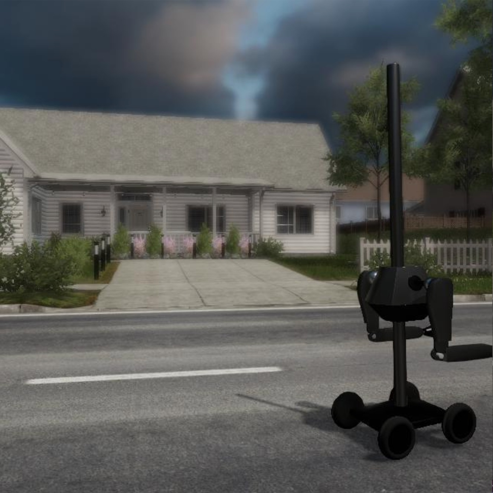
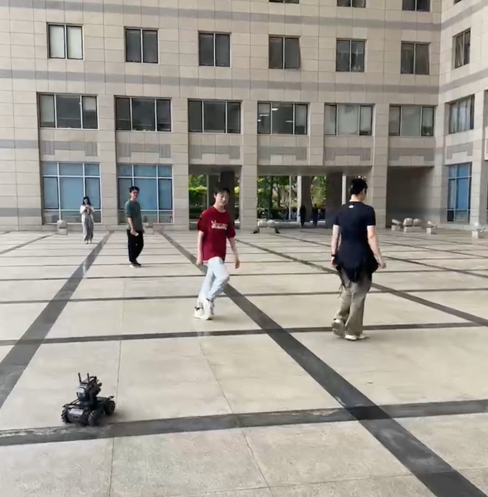

# Real-World Transferring

✨ We deployed tracking policies in real-world scenarios with a target person and multiple distractors (>4) following different movement patterns.

## Introduction

Simulation is only useful if the skills it teaches survive contact with the physical world. To test whether policies trained in UnrealZoo transfer beyond the simulator, we deploy an active visual tracking policy on a physical mobile robot and ask it to follow a target person in a real environment while more than four distractors move around with different motion patterns.

This setting stresses exactly the factors that are hard to reproduce faithfully in simulation: real lighting and shadows, cluttered and unstructured layouts, imperfect perception, and the latency of the perception–control loop on real hardware.

## Deployment Setup

- **Robot platform:** a wheel-based mobile robot carrying the onboard camera used for first-person observations.
- **Task:** active visual tracking — keep the target person in view and follow them through the scene.
- **Distractors:** more than four people moving with different patterns, deliberately crossing the line of sight and occluding the target.
- **Policy:** the offline-RL tracking agent trained on UnrealZoo data (we compare the 1-Env. and 8-Envs. training settings).

*Simulated comparison: ThreeDWorld with its built-in agent "Magnebot" acting as the target, used to evaluate active tracking performance.*

*Real-world deployment: our trained policy running on a wheel-based robot, tracking a target person among distractors.*

## Takeaways

- Policies trained with more diverse environments behave better on the physical robot as well, mirroring the simulation trend: diversity during training is what buys robustness outdoors.
- The gap between simulated and real performance is dominated by perception noise and control latency rather than by the policy itself, which is why the deployment uses the tracking setup with distractors of varying movement patterns.
- Real-world trials remain cheap to reproduce: the same Gym-style interface and observation/action space used in simulation is reused on the robot.
