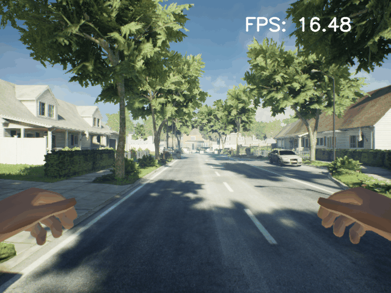
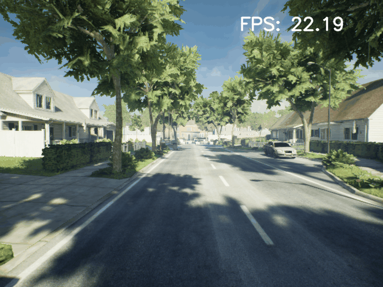

# UnrealCV+

> 📌 Usage guidance of UnrealCV+.

UnrealCV+ is built upon UnrealCV and aims to help researchers build and use virtual worlds based on Unreal Engine (UE4/UE5). It extends the Unreal Engine project with a plugin by providing:

1. A set of commands to interact with the virtual world.
1. Communication between the UE environment and an external program, such as Python.
UnrealCV+ can be used in two ways:

  - The first one is using a compiled game binary with UnrealCV+ embedded. This is as simple as running a game, no knowledge of Unreal Engine is required. 
  - The second is installing the UnrealCV+ plugin to Unreal Engine  (UE4/UE5) and using the editor of UE to build a new virtual world.
# 📦 Install UnrealCV Client


We recommend you use Anaconda to install and manage your Python environment. CV2 is used for image processing, like extracting object masks and bounding boxes. Matplotlib is used for visualization.

Run the command in terminal to install UnrealCV+ client: 

```bash
pip install 'unrealcv>=1.2.0'
```

Note: UnrealCV client versions 1.1.7 and earlier do not support UnrealCV+ APIs.

# 🐍 Python APIs


# Launch the UE Binary

```python
from unrealcv.launcher import RunUnreal

ue_binary = RunUnreal(ENV_BIN=env_bin, ENV_MAP=env_map)

 env_ip, env_port = ue_binary.start(args.use_docker, parse_resolution(args.resolution), args.display, args.use_opengl, args.offscreen, args.nullrhi, str(args.gpu_id))
```

## Connect to UE Environment

```python
from unrealcv.api import UnrealCv_API

# connect to the launched UE environment
# mode: 'tcp' or 'unix', 'unix' is only for local machine in Linux
unrealcv = UnrealCv_API(port=9000, ip='127.0.0.1', resolution=(640,480), 'tcp')

# examples of calling functions by Python APIs
# get the number of cameras
print(unrealcv.get_camera_num())

# get a color image
img = unrealcv.get_image(cam_id=0, mode='lit', show=True)

# disconnect to UE environment
unrealcv.client.disconnect()
```


# 🆕 Improvement in UnrealCV+

> 📌 We have enhanced the FPS (frames per second) in multi-agent settings and image rendering by incorporating parallel processes into the UnrealCV Server. Note that FPS can be further improved by reducing the image resolution, lowering the rendering quality, and decreasing the number of agents in the environment.

### Image Rendering Speed (UnrealCV vs. UnrealCV+)

We enhanced the overall image rendering speed by up to 120%. 

## Multi-agent Interaction Speed (UnrealCV vs. UnrealCV+)

Improving FPS in multi-agent settings can effectively enhance the training and inference of vision-based multi-agent models.

---

# 🆕 Features in UnrealCV+

The examples below use the high-level Python wrapper UnrealCv_API.

Using unrealcv.Client(...) here would be incorrect, because the UnrealCV+ convenience methods such as mount_pak(), capture_panoramic(), start_simple_recording(), spawn_object_from_path(), and annotate_world() are implemented on UnrealCv_API, not on the low-level socket Client.

## Common Setup

```python
from unrealcv import UnrealCv_API

api = UnrealCv_API(
    port=9000,
    ip='127.0.0.1',
    resolution=(640, 480),
)
```

---

## PAK Mounting

The PAK mounting system allows you to load additional content at runtime without rebuilding the project. This is useful for dynamically extending your scene with external assets.

### Usage

The PAK system supports:

- Mounting and unmounting PAK files
- Listing mounted PAKs and checking mount status
- Enumerating files and assets within PAKs
- Scanning and registering assets for use
### Example

```python
from unrealcv import UnrealCv_API

api = UnrealCv_API(port=9000, ip='127.0.0.1', resolution=(640, 480))

pak_path = 'C:/Content/ExtraAssets.pak'

# Mount a PAK file
api.mount_pak(pak_path, pak_order=0)

# Check if a PAK is mounted
if api.is_pak_mounted(pak_path):
    print('PAK is mounted successfully')

# List all mounted PAKs
mounted_paks = api.get_mounted_paks()
for pak in mounted_paks:
    print(f'Mounted: {pak}')

# List files inside the PAK
files = api.get_pak_files(pak_path)
print(f'Files in PAK: {len(files)}')

# Get Unreal asset package paths discovered inside the PAK
assets = api.get_pak_assets_in_pak(pak_path)
print(f'Assets in PAK: {len(assets)}')

# Scan assets from a mounted PAK mount point
api.scan_pak_assets('/Game/ExtraAssets', force_rescan=True)

# Load an asset from the PAK
asset_data = api.load_pak_asset('/Game/ExtraAssets/MyActor.MyActor')
print(asset_data)

# Register assets into the UnrealCV asset pool for spawning
api.register_pak_assets('/Game/ExtraAssets', 'Props')

# Unmount when done
api.unmount_pak(pak_path)
```

---

## Panoramic Camera

Panoramic camera capture generates 360-degree equirectangular images from a point in your scene, useful for VR previews and virtual tours.



### Usage

- Configure per-camera cube map resolution for quality control
- Capture panoramic images directly to file
- Optionally specify output dimensions
It is recommended to use a value of 2^n for resolution and output width and height; otherwise, cracks may appear during image stitching.

### Example

```python
from unrealcv import UnrealCv_API

api = UnrealCv_API(port=9000, ip='127.0.0.1', resolution=(640, 480))

# Use a valid camera identifier.
# Legacy numeric camera ids like 0 also work in many cases.
cam_id = 0

# Set panoramic camera resolution (cube map face resolution)
# Higher values mean better quality but slower capture.
api.set_camera_panoramic_resolution(cam_id, 1024)

# Capture a panoramic image to file.
# The output is an equirectangular projection, typically with 2:1 aspect ratio.
output_path = 'C:/captures/panoramic_01.jpg'
api.capture_panoramic(cam_id, output_path)

# Capture with custom output dimensions
api.capture_panoramic(cam_id, 'C:/captures/pano_360.png', width=4096, height=2048)

# You can also capture to other formats such as EXR if your runtime supports them
api.capture_panoramic(cam_id, 'C:/captures/panoramic.exr')
```

---

## Video Recording Pipeline

The C++ video recording pipeline provides high-performance capture with configurable settings for large-scale generation workflows. Frame rate is dynamically controlled based on in-game time dilation.



### Usage

- start_simple_recording(): Start recording with output path, FPS, duration, and channels
- stop_recording(): Stop an active recording
- is_recording(): Check if a camera is currently recording
- Global settings for movie-quality rendering, viewport capture, warmup frames, and tick intervals
### Example

```python
import time
from unrealcv import UnrealCv_API

# Use your port num (9000 in default), check with 'vget /unrealcv/status' in the console
api = UnrealCv_API(port=9000, ip='127.0.0.1', resolution=(640, 480))


cam_id = 0  # id 0 is your main viewport

# Configure global recording settings
# api.set_use_movie_quality_rendering(False)  # not funcional in v3.0
# api.set_record_via_viewport(False)          # not funcional in v3.0
api.set_warmup_frames(10)

# Start recording a 5-second clip at 30 FPS
# Record options can be: 'lit', 'mask', 'depth', 'normal', 'flow', etc.
output_folder = 'C:/recordings/scene01'
fps = 30
duration = 5.0
record_options = ['lit', 'mask']

api.start_simple_recording(cam_id, output_folder, fps, duration, record_options)

# api.set_recording_paused(cam_id, paused=True)  # not funcional in v3.0
# api.set_recording_paused(cam_id, paused=False) # not funcional in v3.0
# is_paused = api.get_recording_paused(cam_id)   # not funcional in v3.0
# print(f'Paused: {is_paused}')

# Force stop if needed
# api.stop_recording(cam_id)

# Wait for recording to complete
while api.is_recording(cam_id):
    print('Recording in progress...')
    time.sleep(0.5)

print('Recording completed!')
```

---

## Object Spawning from Path

Spawn assets directly using full asset paths, which is more convenient for runtime content loading than class-based spawning.

### Usage

- spawn_object_from_path(): Spawn from full asset path with optional auto-annotation
- set_new_obj(): Still works for class-based spawning and can auto-retry on path-like input
### Example

```python
from unrealcv import UnrealCv_API

api = UnrealCv_API(port=9000, ip='127.0.0.1', resolution=(640, 480))

# Spawn an object from its full asset path
# Format: /Game/Path/To/Asset.AssetName
asset_path = '/Game/Props/Chair_Mesh.Chair_Mesh'
obj_name = 'MySpawnedChair'

# With auto-annotation enabled
spawned_name = api.spawn_object_from_path(asset_path, obj_name)
print(f'Spawned: {spawned_name}')

# Without auto-annotation
stable_name = api.spawn_object_from_path(asset_path, 'MySpawnedChairNoAnno', annotate=False)
print(f'Spawned without annotation: {stable_name}')

# set_new_obj() can also auto-detect path-like input and retry with spawn_object_from_path()
api.set_new_obj('/Game/Props/Table.Table', 'MyTable')
```

---

## Annotation System

The annotation system provides scene labeling for semantic segmentation and object detection training workflows.

### Usage

- annotate_object(): Label a single actor
- annotate_world(): Annotate all actors in the scene
- clear_world_annotation(): Remove all annotations
- Cache management for performance optimization
### Example

```python
from unrealcv import UnrealCv_API

api = UnrealCv_API(port=9000, ip='127.0.0.1', resolution=(640, 480))

# Annotate a specific actor by name
api.annotate_object('Chair_01')

# Annotate all actors in the current world
api.annotate_world()

# Clear all annotations
api.clear_world_annotation()

# Enable annotation cache for better performance
api.set_annotation_cache_enabled(True)

# Clear the annotation cache when done
api.clear_annotation_cache()
```

