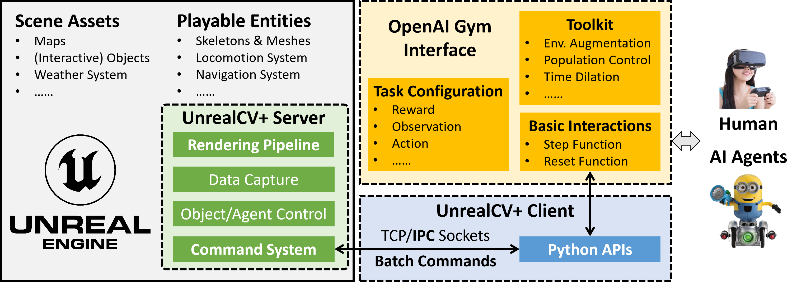

# UnrealZoo Architecture

The detailed architecture of UnrealZoo:

- The Unreal Engine Environments (Binary) contains the scenes and playable entities. 
- The UnrealCV+ Server is built in the UE binary as a plugin, icluding modules for rendering , data capture, object/agent control, and command parsing. We have optimized the rendering pipeline and command system in the server.
- The UnrealCV+ Client provides Python-based utility functions for launching the binary, connecting with the server, and interacting with UE environments. It uses IPC sockets and batch commands for optimized performance. 
- The OpenAI Gym Interface provides agent-level interface for agent-environment interactions, which has been widely used in the community. Our gym interface supports customizing the task in a configuration file and contains a toolkit with a set of gym wrappers for environment augmentation, population control, etc. 

