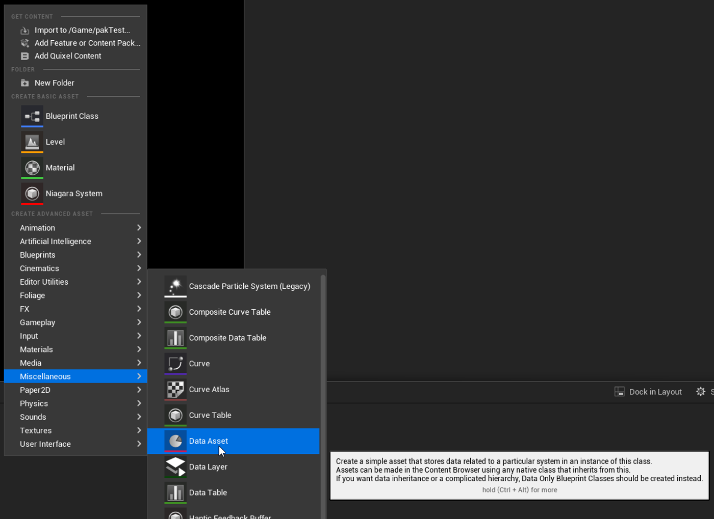
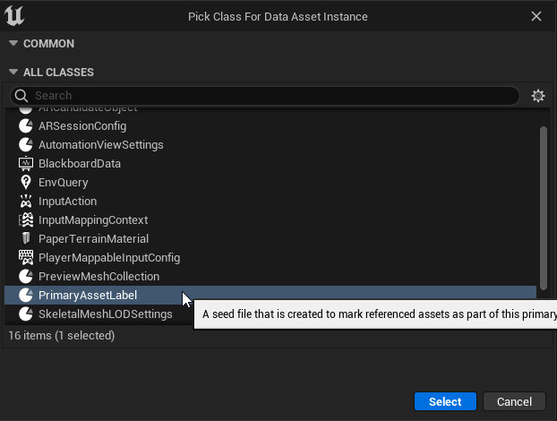
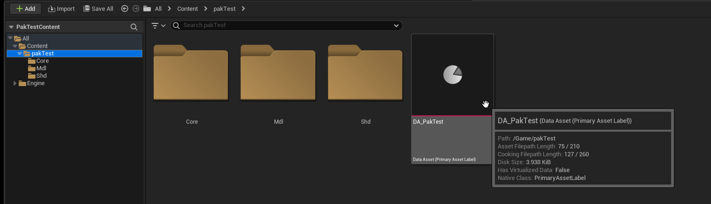
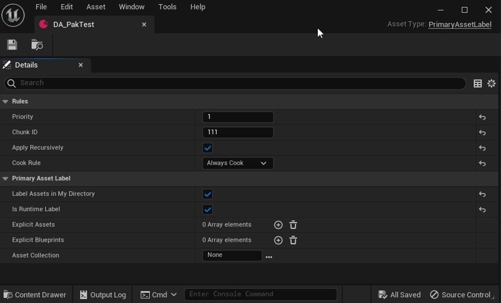
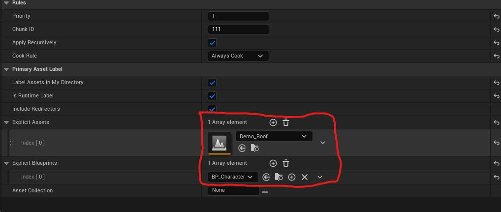
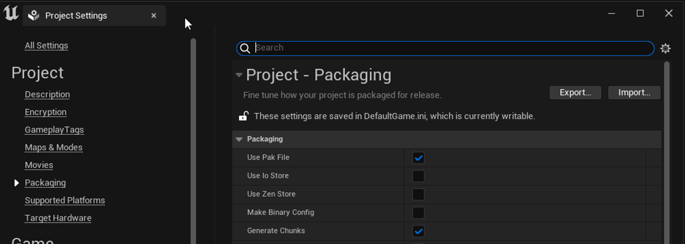

# 导入自定义资产

> 📌 将自定义资产 PAK 文件导入 UnrealZoo 的使用指南。

UnrealZoo 支持通过标准 Unreal Engine PAK 文件加载自定义 Unreal Engine 资产。只需将资产打包为 .pak 文件并放入 UnrealZoo 的 Paks 目录，UnrealZoo 将在启动时自动挂载并扫描这些资产。

---

## 快速开始

1. 将自定义资产放入 UE 项目，例如 `YourProject/Content/MyAssets/`
2. 基于这些资产创建 PAK 文件
3. 将 PAK 文件放入 `.../UnrealZoo_UE5_6_v3.0.1/Windows/UnrealZoo_UE5_6/Content/Paks/`
4. 启动 UnrealZoo，资产将自动挂载

---

## 前置条件

- Unreal Engine 5.6
- UnrealZoo v3.0.0 或更新版本
- 基本熟悉 Unreal Engine 资产创建

---

## 步骤 1. 创建 PAK 文件

UnrealZoo 遵循 Unreal Engine 的标准 PAK 加载机制。请参考 Epic Games 官方教程：

官方教程

https://dev.epicgames.com/community/learning/tutorials/7Bj8/unreal-engine-example-project-loading-pak-files-at-runtime

大致流程如下：

1. 创建一个普通的 Unreal Engine 项目
2. 导入自定义资产
3. 烹饪（Cook）资产
4. 打包为 .pak 文件

---

### 1. 组织资产

将所有需要导出到 PAK 的资产放入一个专用文件夹中。示例：

```plain text
Content/
└── MyAssets/
    ├── Meshes/
    ├── Materials/
    ├── Textures/
    └── Characters/
```

---

### 2. 创建 Primary Asset Label

在 Content Browser 中：

```plain text
Right Click
 └── Miscellaneous
      └── Data Asset
           └── PrimaryAssetLabel
```





创建一个新资产：



配置该资产：

| 设置 | 值 |
| --- | --- |
| Chunk ID | 111 |
| Apply Recursively | Enabled |
| Cook Rule | Always Cook |

> 注意：ChunkId 应为任意大于 0 的唯一正整数，且在 UnrealZoo 内必须唯一。两个 PAK 文件必须分配不同的 ChunkId。Id 0 为保留值，不可使用。



接下来，将所有需要打包进 PAK 文件的资产添加到该 Data Asset 的 Explicit Asset 和 Explicit Blueprint 字段中。关卡、网格体等常规 UAsset 资源放入 Explicit Asset，角色蓝图及类似蓝图资产则添加到 Explicit Blueprint。



---

### 3. 配置打包

打开：

```plain text
Edit
 └── Project Settings
      └── Packaging
```



在 Project Settings 中打开 Packaging 面板。

启用：

- Use Pak File
- Generate Chunks

禁用：

- Use Io Store

若 “Use Io Store” 处于启用状态，请将其禁用。

---

### 4. 配置 Asset Manager

打开：

```plain text
Edit
 └── Project Settings
      └── Asset Manager
```

在 Project Settings 中打开 Asset Manager 面板。

禁用：

- PrimaryAssetLabel - Is Editor Only

![](assets/c9faf7802f3c.png