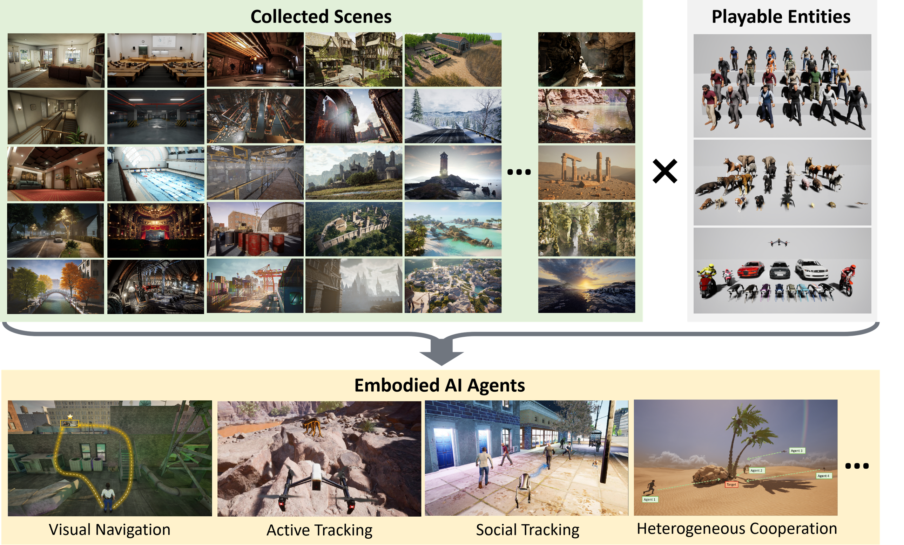

# UnrealZoo

UnrealZoo 是一个建立在 **Unreal Engine** 上的 photo-realistic 3D 虚拟世界集合，旨在反映开放世界的复杂性与多样性。它提供了多种可用于具身智能的可玩实体（playable entities），包括人类角色、机器人、车辆和动物。

UnrealZoo 集成 [UnrealCV](https://unrealcv.org/)，提供了一套易用的 Python API 和工具，支持多种潜在应用，如数据标注与采集、环境增强、分布式训练，以及智能体评测。

> 💡 本仓库（unrealzoo-gym）提供基于 UnrealCV API 的 gym 接口，兼容 OpenAI Gym，支持 UnrealZoo 中的高层智能体-环境交互。

## 为什么选择 UnrealZoo？

| 平台能力 | 研究价值 |
|---|---|
| **100+ photo-realistic 世界与异构智能体** | 在城市场景、自然环境、建筑与工业场景中，用人、机器人、车辆和动物评测具身系统 |
| **具身感知** | 在同一个交互世界中组合 RGB-D、掩码、全景、LiDAR 与占用（occupancy）观测 |
| **交互式多智能体环境** | 研究导航、操作、车辆交互、追踪与异构协同 |
| **运行时可扩展性** | 加载外部 3DGS 环境、定制资产与外观，复用现有智能体与任务 API |
| **端到端智能体工作流** | 连接 Gym 策略、VLN/VLM 系统、Runtime MCP 智能体与数据采集流水线 |

## 选择你的工作流

| 我想做 | 从这里开始 | 运行方式 |
|---|---|---|
| **多智能体协同 / 追踪** | Multi-agent baseline · Tracking example | 二进制自动启动 |
| **交互式导航** | Keyboard navigation | 二进制自动启动 |
| **RGB-D / LiDAR / occupancy 感知** | v3.1 perception guide · LiDAR mapping · Occupancy viewer | 二进制自动启动 |
| **MuJoCo 机器人物理（Go1 / Micro Duck）** | MuJoCo guide | 手动启动二进制或 Editor |
| **VLN / VLM 智能体** | VLN baseline guide | 按模型配置 |
| **Runtime MCP 智能体** | Runtime MCP examples | 连接到运行中的环境 |
| **数据采集 / 标注** | Video recording pipeline · UnrealCV+ 文档 | 手动启动二进制 |