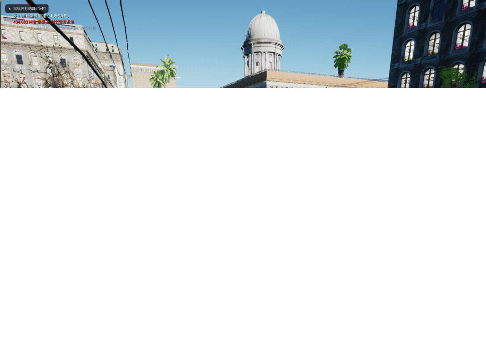

# 导航系统

环境中提供两种控制智能体移动的方式。其一，通过 `set_move` 函数对智能体进行逐步控制，该方式不依赖额外插件，但需要开发者通过外部代码自行管理移动策略；其二，利用 UE 引擎内置的导航网格构建导航系统，实现智能体的自主移动。环境已集成这两种控制方式。将 BP 函数调用进行逐步控制与导航系统控制相结合，可有效利用导航系统控制次级智能体，同时对主控智能体采用逐步控制。这种组合方式具有诸多优势，例如在多智能体场景中提升环境帧率，以及对主控智能体实现更高精度的控制。

## 带导航系统的 BP_functions

| BP_function | input | output | help |
| --- | --- | --- | --- |
| nav_to_goal | {x} {y} {z} |  | 为智能体分配导航目标，利用 Navmesh 和 AI-controller 内置插件自动控制其移动，通过最短路径到达目标。（目标在环境中必须可达。） |
| nav_to_target | {target_object} {distance} |  | 将当前智能体分配到 target_object，利用 Navmesh 和 AI controller 动态跟随 target_object，并在距其指定距离处停下 |
| nav_random |  |  | 控制智能体随机游走 |
| generate_nav_goal |  | { "nav_goal": "X=0.00 Y=0.00 Z=0.00" } | 在智能体周围生成可达的目标位置，并返回该位置。 |

## 示例

