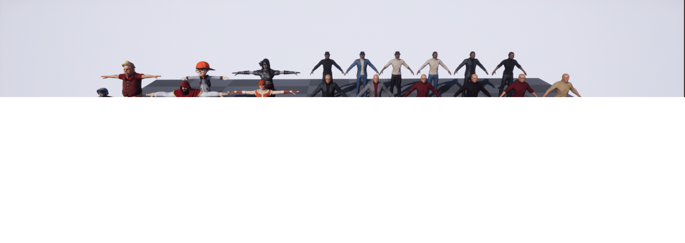
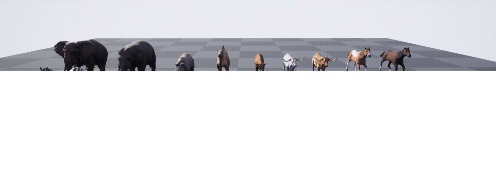
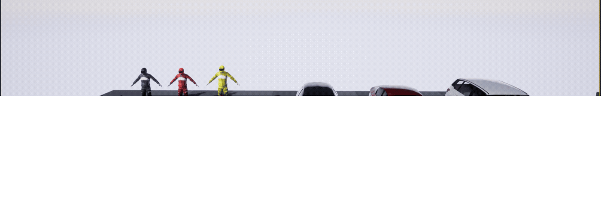
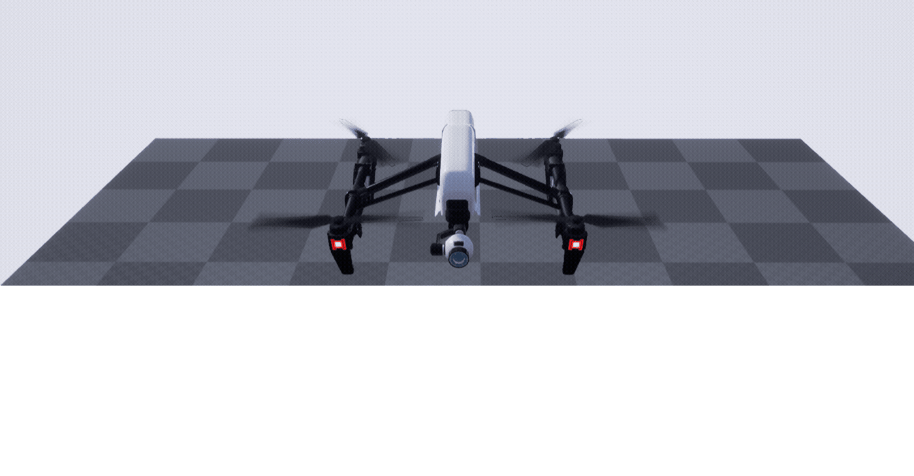
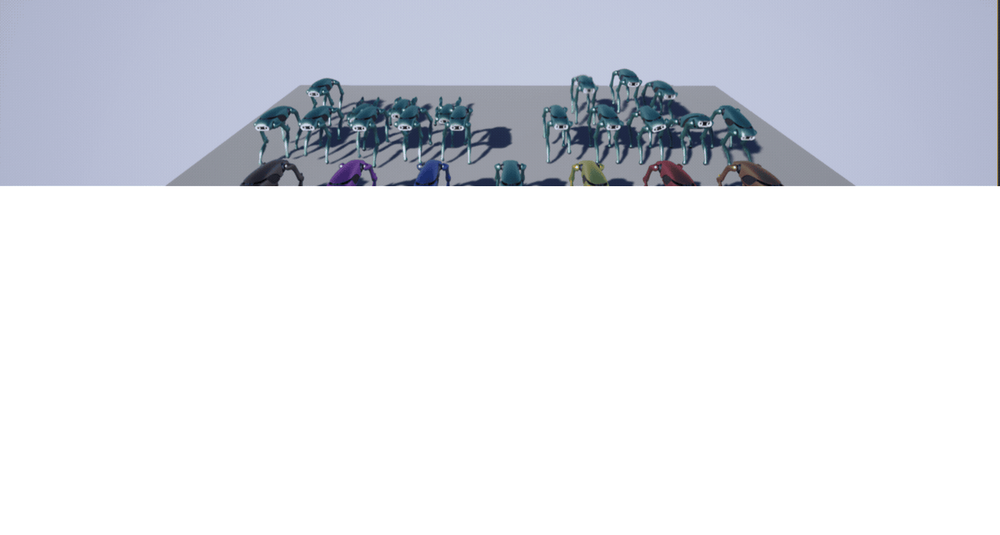

# 可交互实体

# 交互式具身智能体

我们创建了一系列交互式智能体，以满足不同的训练需求，例如目标跟踪、自动驾驶、室内外导航以及无人机任务。研究人员可以轻松选择所需的智能体类型和环境进行训练。我们的平台涵盖六种主要智能体类型：虚拟人类、动物、汽车、摩托车和无人机。

每种智能体类型共享大部分 API 接口，包括运动控制、导航和纹理调整。此外，我们正在开发智能体之间的交互功能。

# 不同智能体展示

## 人类角色 🚶🏻‍♂️🚶🏻‍♀️

虚拟角色使用多样化的网格体来构建丰富且高度逼真的环境。这些虚拟角色可用于创建密集人群和模拟真实城市场景，每个角色均可通过我们的 API 接口进行控制并随机更换外观。




## 动物 🐘 🐕 🐎 🐧 🐢 🐖 🐏 🐂




## 车辆 🏍️ 🚗

我们还开发了多种类型的车辆，包括汽车和摩托车。这些车辆可用于自动驾驶和动态交通场景模拟等额外任务。

### UE4



### UE5

💡请注意，在最新的 UE5 版本中，为支持更逼真的混沌系统，每辆车都有各自的类名，set_app 不再能更改外观。如需使用其他车辆，请生成新的车辆实例。


## 无人机 🛩️

无人机可通过我们的 API 像车辆一样进行控制。它可用于多智能体协作或异常检测等任务。




## 移动机器人 🤖





## 可拾取物体 🧸

人类角色可使用 set_pickup 来拾取/放下物品，研究人员可通过 API 将其设置在地图上的任意位置，并使用 set_app 更改其外观。


# API：

我们利用 Unreal Engine 中的蓝图函数来构建这些用于控制智能体的 API。开发者可按照 UnrealCV 命令系统，通过内置控制台或 Python 代码中的 UnrealCV 直接调用：

```python
vbp [obj_name] [func_name] [arg1] [arg2] …
```

obj_name 为实体实例的名称，例如 bp_character_2

func_name 为蓝图函数的名称，例如 nav_to_object

arg 为蓝图函数的输入参数，例如目标位置坐标。


> 💡以下链接页面详细说明了各类可交互实体的蓝图 API


类名：BP_Character_C

新增动画（躺下、攀爬、蹲伏、滑行等）

vbp {instance_name} {bp_function} {args 1} {args2}…


类名：BP_animal_C


| BP_function | input  | output  | help |
| --- | --- | --- | --- |
| set_move | {angular} {velocity} |  | 通过角度和线速度控制物体单步移动： |
| nav_to_goal | {x} {y} {z} |  | 为智能体指定导航目标，利用 Navmesh 和 AI-controller 内置插件自动控制其沿最短路径到达目标。（目标在环境中必须可达。） |
| nav_random |  |  | 控制智能体随机游走 |
| set_speed | {speed} |  | 设置智能体物体的最大速度 |
| set_interval | {value} |  | 设置模拟动画的时间间隔。value：1 ~ 1000 |
| set_acc | {acceleration} |  | 设置智能体物体的最大加速度 |
| set_phy  | {value} |  | 模拟物理，0：关闭，1：开启 |
| set_app  | {id} |  | 设置智能体物体的外观，id：0~27 |
|  |  |  |  |
|  |  |  |  |
|  |  |  |  |
|  |  |  |  |
|  |  |  |  |
|  |  |  |  |
|  |  |  |  |
|  |  |  |  |
|  |  |  |  |

移动机器人与人类角色共享同一类（BP_character_C），开发者可直接使用 set_app 将网格体更换为机器狗（id：20~33）。


| BP_function | input  | output  | help |
| --- | --- | --- | --- |
| set_move | {angular} {velocity} |  | 通过角度和线速度控制物体单步移动： |
| nav_to_goal | {x} {y} {z} |  | 为智能体指定导航目标，利用 Navmesh 和 AI-controller 内置插件自动控制其沿最短路径到达目标。（目标在环境中必须可达。） |
| nav_to_target | {target_object} {distance} |  | 将当前智能体指定到 target_object，利用 Navmesh 和 AI controller 动态跟随 target_object，并在距其指定距离处停止 |
| nav_random |  |  | 控制智能体随机游走 |
| set_speed | {speed} |  | 设置智能体物体的最大速度 |
| set_interval | {value} |  | 设置模拟动画的时间间隔。value：1 ~ 1000 |
| set_acc | {acceleration} |  | 设置智能体物体的最大加速度 |
| set_phy  | {value} |  | 模拟物理，0：关闭，1：开启 |
| set_cam  | {x} {y} {z} {row} {pitch} {yaw}  |  | 设置相机相对于 actor 的位姿 |
| set_app  | {id} |  | 设置智能体物体的外观，id：20~33 |
| set_photo_mode |  |  | 将视角切换为智能体的第一人称视角。再次执行该命令可切换回第三人称视角。 |
| generate_nav_goal |  | { ”nav_goal”: “X=0.00 Y=0.00 Z=0.00” } | 在智能体周围生成一个可达的目标位置，并返回该位置。 |
|  |  |  |  |
| get_hit |  | { ”hitresult”: “true(or false)” } | 获取智能体物体（与其他目标或静态物体）的碰撞标志，返回 true 或 false。 |
| get_speed |  | { ”speed”: “0.000” } | 获取智能体的线速度，返回该值 |
| get_angle |  | { ”angle”: “0.000” } | 获取智能体的角速度，返回该值 |
|  |  |  |  |

类名：BP_Drone01_C

| BP_function | input  | output  | help |
| --- | --- | --- | --- |
| set_move | {x} {y} {z} {yaw} |  | 通过各轴（x、y、z、yaw）的力控制物体，取值范围为 -1 到 1 |
| set_rotation | {yaw} |  | 设置无人机在世界坐标系中的绝对旋转位置。 |
| set_speed | {speed} |  | 设置智能体物体的最大速度 |
| set_interval | {value} |  | 设置模拟动画的时间间隔。value：1 ~ 1000 |
| set_acc | {acceleration} |  | 设置智能体物体的最大加速度 |
| set_phy  | {value} |  | 模拟物理，0：关闭，1：开启 |
| set_cam | {x} {y} {z} {row} {pitch} {yaw}  |  | 设置相机相对于 actor 的位姿 |
| set_viewport |  |  | 执行此命令后，Game 窗口将显示智能体的第一人称视角。再次输入该命令可将窗口切换为自由漫游视角。 |
|  |  |  |  |
|  |  |  |  |
|  |  |  |  |
|  |  |  |  |
|  |  |  |  |
|  |  |  |  |
|  |  |  |  |
|  |  |  |  |


此交互必须与人类角色配合使用

vbp {character name} set_pickup


类名： BP_GrabMoveDrop_C

vbp {instance_name} {bp_function} {args1} {args2} ...

| BP_function | input  | output  | help |
| --- | --- | --- | --- |
| is_picked |  | { “is_picked”：“0” } | 返回物体状态，是否被拾取（0/1） |
| set_app  | {id} |  | 设置智能体物体的外观，id：0~20 |

## 💡提示

您可以通过调用 unrealcv api 手动生成可拾取物体并设置其位置：

self.unrealcv.set_new_obj(self, class_name, obj_name)

self.unrealcv.set_obj_location(self, obj, loc)

示例：

self.unrealcv.set_new_obj(self, BP_GrabMoveDrop_C, pickable_object_1)

self.unrealcv.set_obj_location(self, pickable_object_1, [0,0,100])


# 示例

### 1. 基础运动控制

```python
vbp bp_character_2 set_move 0 100
vbp bp_character_2 set_move 20 100
# 逐步控制智能体的运动，
# 通过给定的角度和速度参数指定移动速度和方向。
# 单步执行的间隔时间可通过 "set_interval" 自定义调整
```

<video controls width="640" src="assets/Collection_-_%E8%99%9A%E5%B9%BB%E7%BC%96%E8%BE%91%E5%99%A8_2024-04-22_10-29-14_set_move_2.mp4"></video>


### 2. 高级运动控制

```python
# 用于更复杂的探索任务

vbp bp_character_2 set_crouch
vbp bp_character_2 set_move 0 100
# 设置蹲伏并穿过一些狭窄障碍物
```

<video controls width="640" src="assets/Collection_-_%E8%99%9A%E5%B9%BB%E7%BC%96%E8%BE%91%E5%99%A8_2024-04-22_11-12-05_set_crouch.mp4"></video>

```python
vbp bp_character_2 set_move 45 100
vbp bp_character_2 set_jump
# 当智能体面对低矮障碍物时，可以跳跃并翻越障碍物
```

<video controls width="640" src="assets/Collection_-_%E8%99%9A%E5%B9%BB%E7%BC%96%E8%BE%91%E5%99%A8_2024-04-22_11-25-50_jump.mp4"></video>

```python
vbp bp_character_2 set_liedown 100 0
vbp bp_character_2 set_standup
# 模拟跌倒动作，给定跌倒方向，
# 以及恢复动画。
```

<video controls width="640" src="assets/Collection_-_%E8%99%9A%E5%B9%BB%E7%BC%96%E8%BE%91%E5%99%A8_2024-04-22_10-35-27_liedown.mp4"></video>

### 3. 通过导航系统控制运动

```python
vbp bp_character_2 nav_to_object bp_animal_2 200
# 使用导航系统控制 bp_character 移动到特定物体（bp_animal_2），
# 并在到达 200 的半径范围时停止
```

<video controls width="640" src="assets/Collection_-_%E8%99%9A%E5%B9%BB%E7%BC%96%E8%BE%91%E5%99%A8_2024-04-23_15-29-46_nav_to_object_natrue.mp4"></video>

```python
vbp Sport_2 set_viewport
vbp bp_basecar_2 nav_to_goal -1620 -3071 487
vbp Sport_2 set_viewport
# 显示摩托车智能体的第一人称视角。
# 使用导航系统控制摩托车智能体沿最短路径导航至环境中的指定位置
# 显示自由漫游视角
```

<video controls width="640" src="assets/Collection_-_%E8%99%9A%E5%B9%BB%E7%BC%96%E8%BE%91%E5%99%A8_2024-04-23_18-13-10_motorbike_nav_to_goal.mp4"></video>


### 4. 拾取/放下物体

```python
vbp bp_character_2 set_pickup
# 显示人类智能体的第三人称视角。
# 当人类智能体进入可交互物体的范围时，
# 'set_pickup' 命令或按键盘 'E' 将触发物体交互动画。
# 再次调用 set_pickup，智能体将放下物体。

```

<video controls width="640" src="assets/85ea109a40109f68a5b11bab3ec51734.mp4"></video>


### 5. 开门

```python
vbp bp_character_2 set_opendoor 1 #开门
vbp bp_character_2 set_opendoor 0 #关门

# 显示人类智能体的第一人称视角。
# 当人类智能体进入可交互门的范围时，
# 'set_opendoor' 命令或按键盘 'E' 将触发门交互动画。
```

<video controls width="640" src="assets/Open_Door.mp4"></video>