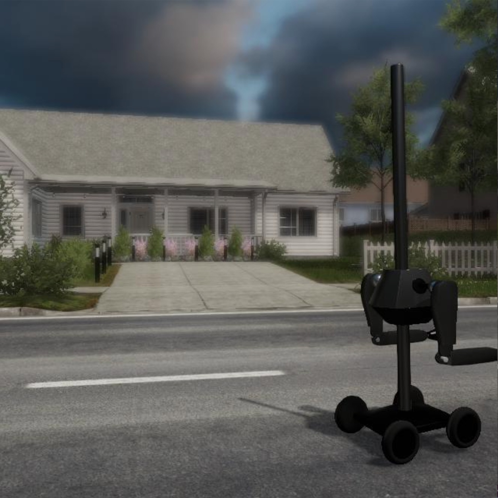
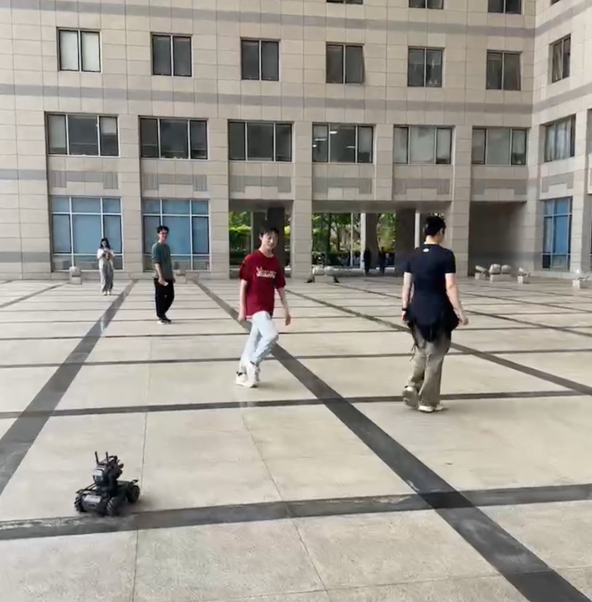

# 真实世界迁移

✨ 我们在真实场景中部署了跟踪策略，目标人物与多个（>4）以不同运动模式移动的干扰者同时存在。

## 引言

仿真只有在它所教授的技能能够经受物理世界检验时才有价值。为测试在 UnrealZoo 中训练的策略能否迁移到仿真器之外，我们将主动视觉跟踪策略部署到一台物理移动机器人上，要求其在真实环境中跟随目标人物，同时有四个以上干扰者以不同运动模式移动。

该设置恰好强调了难以在仿真中忠实复现的因素：真实光照与阴影、杂乱且非结构化的布局、不完美的感知，以及真实硬件上感知–控制回路的延迟。

## 部署设置

- **机器人平台：** 一台轮式移动机器人，搭载用于第一人称观测的机载相机。
- **任务：** 主动视觉跟踪——将目标人物保持在视野内并跟随其穿过场景。
- **干扰者：** 四个以上以不同模式移动的人员，刻意穿越视线并遮挡目标。
- **策略：** 在 UnrealZoo 数据上训练的离线 RL 跟踪 agent（我们比较了 1-Env. 与 8-Envs. 两种训练设置）。

*仿真对比：ThreeDWorld 及其内置 agent“Magnebot”充当目标，用于评估主动跟踪性能。*

*真实世界部署：我们训练好的策略在轮式机器人上运行，在干扰者中跟踪目标人物。*

## 要点

- 在更多样化环境中训练的策略在物理机器人上同样表现更好，与仿真趋势一致：训练期间的多样性是获得户外鲁棒性的关键。
- 仿真与真实性能之间的差距主要来自感知噪声和控制延迟，而非策略本身，这也是部署采用带有不同运动模式干扰者的跟踪设置的原因。
- 真实世界试验的复现成本仍然很低：仿真中使用的相同 Gym 风格接口和观测/动作空间在机器人上被复用。