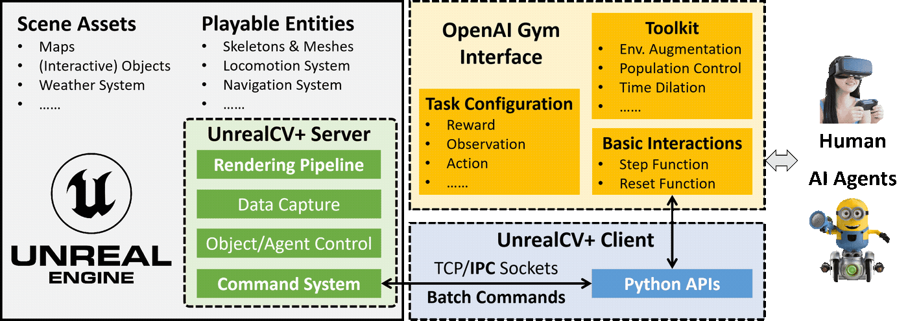

# UnrealZoo 架构

UnrealZoo 的详细架构如下：

- Unreal Engine Environments（二进制）包含场景和可操控对象。
- UnrealCV+ Server 作为插件构建在 UE 二进制中，包含渲染、数据捕获、对象/智能体控制以及命令解析等模块。服务器中的渲染管线和命令系统已优化。
- UnrealCV+ Client 提供基于 Python 的工具函数，用于启动二进制、连接服务器以及与 UE 环境交互。采用 IPC socket 和批量命令优化性能。
- OpenAI Gym Interface 提供智能体级别的接口，用于智能体-环境交互，已在社区中广泛使用。Gym 接口支持在配置文件中自定义任务，并包含工具包，提供一组用于环境增强、种群控制等的 gym wrapper。

